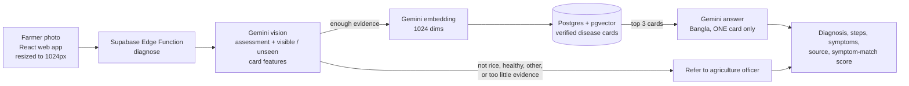

# Crop Guardian: Project Build Report

*International AI Builders Congress (AIBC) 2026 · AgriSphere AI · challenge area "Crop Guardian"*
*Snapshot as of 2026-11-20. The living documentation is in [`docs/`](docs/index.md); start with the [project guide](docs/concepts/project-guide.md).*

**Live app:** https://crop-guardian-ten.vercel.app · **Code:** https://github.com/mahmudscode/Crop_Guardian

---

## 1. Summary

Crop Guardian lets a Bangladeshi rice farmer photograph a sick leaf and receive a short Bangla answer: a likely disease, what to do now, how to prevent it, the cited source, and how many of the disease's described symptoms were seen. If the photo is unclear, shows a healthy-looking leaf, or does not clearly match a disease we hold advice for, the app says it is not sure and refers the farmer to the local agriculture officer.

What is real today:

- A working end-to-end system: React web app, Supabase backend (database with vector search and two Edge Functions), Google Gemini for vision, answers and embeddings, all on free tiers and live on the internet.
- Five disease cards written from cited sources (IRRI and the Pacific Pests, Pathogens and Weeds database).
- A re-runnable evaluation harness and an honest first measurement.

What is not yet established, stated plainly: **diagnostic accuracy**. Our first measurement shows the AI cannot yet reliably tell these diseases apart from photos. We built safeguards that make it refuse more often, and we report the numbers below without rounding them up.

## 2. Problem and users

Rice is Bangladesh's staple crop. Smallholder farmers often cannot identify a disease or pest early; extension officers are hard to reach; most agronomy material is in English or long documents. Wrong or late treatment causes crop loss.

- **Users:** smallholder rice farmers and field extension workers, on basic phones with weak connections.
- **One core use case (deliberately):** photo in, Bangla diagnosis out.
- **Scope:** blast, bacterial leaf blight, brown spot, sheath blight, tungro (cards written) and hispa (an insect pest; card still missing).
- **Intended outcome:** earlier, correct action to reduce field-level loss. The measured KPI proposed is diagnosis accuracy on a labelled photo set (see section 7).

## 3. Solution and design principles

1. **The AI observes; the cards advise.** The model never writes treatment from its own memory. Advice comes only from disease cards written from cited source text and checked by a human.
2. **Refuse rather than guess.** Not rice, unclear, healthy-looking, or too little visible evidence all lead to "not sure, ask the officer".
3. **Bangla first.** UI, symptoms shown to the farmer and answers are in simple Bangla.
4. **No account, no stored photos.** The photo is processed in memory and never saved by this project.
5. **One core use case.** No extra features.

## 4. System architecture



**Request flow**

1. **Upload.** The app shrinks the photo (max 1024 px, JPEG) and calls the `diagnose` function.
2. **Observe.** Gemini is shown the name and source symptom text of every *verified* card and must first judge the leaf: `healthy`, `listed` (clearly matches a card), `other` (damage matching no card) or `unclear`. For `listed` it names up to 3 candidates *from that list only* and, for each, the card features it can see and the ones it looked for and did not see.
3. **Evidence gate.** The confidence is computed in code as matches / (matches + not seen). A disease is offered only with at least 2 visible features and a ratio of at least 0.5. The model's own confidence number is not used (see section 7 for why).
4. **Retrieve.** Symptoms and candidate names are embedded; pgvector returns the 3 nearest verified cards, and the top candidate's card is always included.
5. **Answer.** Gemini picks one card and writes Bangla sections (diagnosis worded as "likely", what to do, prevention) from that card's text only. The app adds that card's source.
6. **Resilience.** A per-IP rate limit protects the free quota; if the main Gemini model is overloaded, out of quota, closed to the account or times out, the backend automatically tries fallback models and reports which one answered.

**Data model.** One table, `disease_cards` (names in English and Bangla, symptoms, cause, treatment, prevention, source name/URL/page, `verified`, `verified_by`, a 1024-dimension embedding). Row-level security exposes only verified cards. A database function returns the nearest cards.

**Stack and why**

| Layer | Choice | Reason |
|---|---|---|
| UI | React + Vite + Tailwind, hand-built | Full control and version history in the repo (a UI generator was considered and dropped) |
| Backend | Supabase Edge Functions (Deno) | Keeps keys server-side; one place for the pipeline |
| Database / search | Supabase Postgres + pgvector | Same database as app data |
| AI | Google Gemini (free tier): vision, answers, embeddings | The team chose to use no paid services; no model training needed |
| Hosting | Vercel (web app), Supabase (backend) | Free tiers, no servers to manage |

## 5. Knowledge base and data

**Disease cards** are written only from source text, with pesticide names copied as the source writes them and no doses (none of the sources give doses; the cards tell the farmer to ask an officer).

| Card | Source |
|---|---|
| Blast, brown spot, bacterial leaf blight | *Pacific Pests, Pathogens and Weeds*, online edition v10 (G. Jackson, 2021) |
| Sheath blight, tungro | IRRI, *Rice Diseases: Biology & Selected Management Practices* (Opulencia & Hettel, eds., 2018), chapters read from the published PDFs |
| Hispa | **Not written yet** (no source text obtained: the IRRI Knowledge Bank and PhilRice hosts refused connections, BRRI had a certificate error) |

The Bangla in the cards is a machine translation of the English source text. **It has not been reviewed by a native speaker**, and the cards have not yet been verified by a second person against their sources. For testing, the live database marks them verified with the label "TEST ONLY - not human-reviewed".

**Evaluation data.** Public photos from the `Project-AgML/rice_disease_classification_bangladesh` dataset (CC BY 4.0), a small sample only. No photos are committed to the repository.

## 6. Responsible AI, privacy and data sovereignty

| Concern | What we did | What is still weak |
|---|---|---|
| Wrong diagnosis | Evidence gate, "likely" wording, symptom-match score instead of a fake probability, officer referral | Most answers still shown in our test were wrong (section 7) |
| Invented advice | Answer step limited to one card's text; cards from cited sources | Cards await human verification; Bangla unreviewed |
| Privacy | Photos processed in memory, never stored by us; no account | Photos are sent to Google's Gemini API; the free tier's terms may let Google use submitted content, so we do not claim photos never leave the user's control |
| Data ownership | Knowledge base is open, cited agronomy text | Farmer photos still leave the device for analysis |
| Language bias | Bangla-first UI and answers | No test with real farmers yet |
| Out-of-scope input | Non-rice, unclear and healthy-looking photos handled separately | Diseases with no card are often still named as a disease we do have |
| Honesty of claims | Only measured numbers are reported; a flawed test image was caught and excluded | |

## 7. Evaluation: what we measured and what it means

**Setup.** 42 public photos, 6 per class: blast, tungro, healthy, and four problems we have *no card for* (insect damage, leaf scald, leaffolder, stripes), for which the right answer is "not sure". The photos are single leaves on white backgrounds, easier and different from phone photos in a field. Six photos per class is tiny and the dataset labels are not independently verified. **This is a smoke test, not a KPI.**

| Method | Blast + tungro right (of 12) | Healthy not flagged (of 6) | No-card photos refused (of 24) | Answers shown | Wrong answers shown |
|---|---|---|---|---|---|
| Gemini, first version (self-reported confidence) | 5 | 4 | 1 | 35 | 30 |
| Pretrained rice classifier alone (EfficientNet-B0) | 2 | 6 | 13 | 18 | 16 |
| Both must agree | 1 | 6 | 23 | 3 | 2 |
| Gemini + evidence gate, ratio 0.6 | 0 | 6 | 24 | 0 | 0 |
| **Gemini + evidence gate, ratio 0.5 (deployed)** | **2** | **6** | **14** | **16** | **14** |

**Findings**

- **The first version over-claimed.** It named a disease for 35 of 42 leaves, including 23 of the 24 photos of problems we have no card for. Its self-reported confidence did not separate right from wrong: in an offline analysis no confidence or margin cutoff helped, and at 0.85 and above every answer shown was wrong. We therefore removed it.
- **The evidence gate made it safer, not smarter.** Wrong answers shown fell from 30 to 14, healthy leaves are never flagged, and 14 of 24 unsupported-problem photos now get "not sure". But correct detections fell from 5 to 2 of 12, and about 88% of the answers still shown are wrong. The AI mostly learned to say less; it still cannot reliably tell these diseases apart on these photos.
- **A pretrained rice classifier did not rescue it.** Its model card reports about 97% on its own split, but on our photos it found the disease in only 2 of 12. This is the lab-to-field gap its own card warns about. Combining it with Gemini ("both must agree") is safe but almost never answers.
- **A stronger Gemini model was tried and abandoned** after 11 photos: 20 to 40 seconds or more per photo, and it exhausted the free quota.
- **The 0.5 cutoff was chosen after seeing results on the same photos**, so the deployed numbers are optimistic.
- **Speed.** Median 4.8 s per photo (maximum 15.7 s) for the deployed version.
- **Corrections along the way.** Our very first test image turned out to be an eight-panel figure of cabbage, citrus and rice, so an early "correct diagnosis" was meaningless and was retracted; a 0.6 ratio refused every photo because a card listed features (stem and neck rot) that can never be visible on a single leaf.

**What would give a real number:** 10 to 15 or more expert-labelled photos per disease from a licensed dataset, plus phone photos from real fields, evaluated before any accuracy claim. Scripts and raw results are in [`eval/`](eval/README.md); details in [`docs/operations/evaluation.md`](docs/operations/evaluation.md).

## 8. How it was built

Built in one intensive session on 2026-11-20 with an AI coding assistant, working in small verified steps.

1. **Requirements to documentation.** The two hackathon PDFs were turned into the project documents: problem, architecture, prompts, safeguards, evaluation plan, demo script and a submission checklist.
2. **Backend.** Supabase schema with pgvector, vector search function, row-level security, and two Edge Functions, deployed to a free Supabase project.
3. **Frontend.** A hand-built Bangla React app, replacing the originally planned UI generator.
4. **Knowledge base.** Five cards written from cited source text; hispa blocked by unreachable sources.
5. **Cost decision.** Moved the AI from a paid model to Google Gemini's free tier, including re-embedding every card.
6. **Hardening.** Fail-fast timeouts, per-IP rate limit, a one-card grounded answer, type-checking the functions on Deno, and a browser test of the real flow.
7. **Evaluation and fix.** A reproducible comparison on 42 photos, a classifier trial, then the evidence gate.
8. **Deployment.** Web app on Vercel; first deploy failed because two environment variables were not applied at build time, which we diagnosed from the deployed code and fixed. Added model fallback after finding Google's free models can be unavailable for hours.
9. **Documentation.** A wiki with a one-page project guide for people and AI assistants, kept in step with the code by a linter.

**Lessons**

- Free AI tiers are unreliable: models get overloaded, run out of quota, or close to new accounts. Plan fallbacks and a recorded demo.
- A model's self-reported confidence is not evidence; computing it from listed evidence is better but does not make the model more accurate.
- Test data needs trustworthy labels and honest scope; check images before using them.
- Environment variables baked in at build time fail silently; verify the deployed bundle, not just the dashboard.

## 9. Scalability roadmap

Near term (needed before real use): a validated accuracy measurement; native-speaker and agronomist review of every card; hispa and additional diseases (cards, not retraining, are the unit of growth); a stronger or fine-tuned vision component trained on phone photos from Bangladeshi fields.

Later: Bangla voice input and output; WhatsApp or SMS front end for low-bandwidth users; offline-first app with cached cards; partnership with the Department of Agricultural Extension so officers review flagged cases (human in the loop); other crops and countries by swapping the card set and language.

Constraints to be honest about: the free tiers have request and quota limits and will not serve large numbers of farmers; scaling needs paid capacity or a different hosting plan.

## 10. Business value and viability

This section separates three kinds of statement: **sourced** facts (with the source), **measured** numbers from this project, and **assumptions** that a pilot must test. It contains no market-size estimate, because we have no verified one, and no price, because pricing should come from the pilot.

### 10.1 The problem has a measurable economic size

All loss figures below are quoted from the cited sources; they measure different things (national averages, field surveys, experiments) and must not be added together.

| Disease | What the sources say | Source |
|---|---|---|
| Blast | BRRI says about 1% of Bangladesh's roughly four crore (40 million) tonnes of annual rice production is damaged by blast; in severely affected areas damage can reach 100%. One percent of that production is about **400,000 tonnes a year** (our arithmetic) | The Business Standard, 28 Jan 2024, quoting BRRI |
| Bacterial leaf blight | In a BRRI field experiment on a susceptible variety, inoculated plots lost **5.8% to 30.4%** of yield, and infection at the mid-tillering, panicle-initiation and boot stages gave 21% to 30.4%. This is an experiment, not a national average | Ansari et al., *Bangladesh Rice Journal* 23(1), 2019 |
| Sheath blight | Average yield loss of about **6%** in tropical and subtropical Asia, higher than other rice diseases; heavier on high-input, high-yield crops | IRRI, *Rice Diseases: Biology & Selected Management Practices* (2018), sheath blight chapter |
| Tungro | Average annual losses in the 1980s were estimated to exceed **USD 1,500 million**, with serious outbreaks repeatedly in Bangladesh and other countries (a historic estimate, not current) | IRRI (2018), tungro chapter, citing Herdt 1987 |

The commercial logic is early, correct action: the earlier a farmer recognises a disease and acts, the more of that loss is avoidable. How much of it Crop Guardian actually avoids is **not measured yet**; that is what a pilot must establish (10.6).

### 10.2 Who gets value, and who could pay

The people who benefit most (smallholder farmers) are the least able to pay, so the plan is **free for farmers, paid for by organisations that already invest in farmer advice.** Everything in the right-hand column is an assumption.

| Party | Value to them | Possible way to pay (to be tested) |
|---|---|---|
| Smallholder farmers | Fast, Bangla, cited first-line guidance without a trip or a wait | Free |
| Agricultural extension services | An extension network that is stretched thin: a 2011 scoping mission (report approved by USAID/Bangladesh, posted 2015) counted about 12,600 field officers, one per block of roughly 2,500 to 3,000 farm households, and said most farmers never meet their officer (figures are about a decade old). The app triages cases so officers see the uncertain and serious ones | Annual licence per upazila or programme, or a government or donor-funded rollout |
| NGOs and donor-funded agriculture projects | A reportable, low-cost advisory channel with measurable reach | Project-budget licence including card updates and support |
| Lenders, cooperatives, insurers | Early warning of outbreaks and loss reduction | Subscription to aggregated, anonymised outbreak insight (needs consent and a privacy design; **not built**) |
| Agri-input companies | A trusted channel to farmers | **Handle with care:** advice must stay card-based and neutral. A conflict of interest would destroy trust, so any arrangement must be clearly labelled and kept separate from the diagnosis |

### 10.3 Unit economics (measured, with caveats)

We measured the real AI usage of one diagnosis on four photos: about **1,900 input tokens and 500 output tokens (including the model's thinking)**, across the vision call and the answer call, plus a very small embedding call.

At the paid prices Google lists for `gemini-3.1-flash-lite` (USD 0.25 per million input tokens and USD 1.50 per million output tokens, and USD 0.15 per million for the embedding model, read from Google's pricing page through a summary and **not yet verified against the verbatim page**), that is about **USD 0.0012 per diagnosis, roughly USD 1.2 per thousand and USD 1,200 per million**.

Read this correctly:

- Four photos is a small sample, and token use varies with the photo and prompt. Retries and fallback calls add to it.
- It covers only the AI calls. It excludes hosting beyond the free tiers, support, and the **real fixed costs: expert verification of every card, Bangla review, and keeping cards current.**
- The prototype runs on free tiers at zero cost, but Google's pricing page states that **free-tier content is used to improve its products and paid-tier content is not.** A deployment that handles farmers' photos should use the paid tier, so the cost above is the relevant one for a real product.

The takeaway: inference is cheap enough that it is not the constraint. The business depends on expert review, delivery and trust, not on compute.

### 10.4 Revenue model options

1. **Organisation licence (preferred starting point):** an annual fee per upazila or programme covering access, card updates and support. Predictable, and aligned with how extension and NGO programmes are funded.
2. **Usage-based fee per diagnosis:** possible because the unit cost is tiny, but it makes farmers' use a cost to the payer, so it suits programmes with a fixed caseload better than open access.
3. **Aggregated insight subscription:** outbreak maps for lenders, cooperatives and officers. High value in principle; requires location and consent handling that the current design deliberately avoids, so it is a later phase.

Prices are not proposed here. They should be set after learning what a pilot partner already spends on advisory services.

### 10.5 How a farmer's value is measured (inputs, and what we know)

Expected loss avoided per farmer per season is: *yield × price × disease loss rate × share of the loss that earlier correct action prevents × the share of farmers who follow the advice.*

| Input | Status |
|---|---|
| Disease loss rates | Sourced ranges above, mostly from experiments or regional averages |
| Yield and rice price | Not gathered (needs current official data) |
| Share of loss prevented by earlier correct action | **Unknown. Must be measured in a pilot** |
| Share of farmers who follow the advice | **Unknown. Must be measured** |
| Correct-diagnosis rate of the app | **Not established** (see section 7); this multiplies every benefit above |

### 10.6 Path to a sustainable business

| Stage | What happens | What must be true before moving on |
|---|---|---|
| 0. Now | Working prototype, honest evaluation | Accuracy measured on expert-labelled and phone photos; cards verified by an agronomist; Bangla reviewed by a native speaker |
| 1. Pilot | One or two upazila extension offices or an NGO programme, a test group and a comparison group | Measured accuracy in the field; officer time saved; farmer return rate; advice followed; loss avoided; real cost per diagnosis |
| 2. Paid programmes | Licences to extension services and NGO programmes | A partner willing to pay, with a measured benefit to point to |
| 3. Expansion | More crops and regions by adding cards; voice and SMS or WhatsApp access | Card authoring and review process that scales without more engineering |

### 10.7 Risks to viability

- **Accuracy is not established** (section 7). Until it is, the product is decision support that often says "not sure", and an organisation will rightly hesitate to pay or to take liability for advice.
- **Trust and neutrality.** One bad recommendation, or a perceived commercial bias, would damage adoption. Advice stays strictly card-based, with no doses from memory.
- **Platform dependence.** The prototype depends on Google's free tier, which is unreliable and has data-use terms unsuitable for production. Moving to the paid tier or an alternative provider is a known cost and change.
- **Access.** Many smallholders do not have a smartphone or mobile internet. Press coverage of GSMA's 2024 survey reports rural smartphone ownership well below urban (about 26% against 41%), but we could not open the source: **verify before quoting.** This is why an officer-facing channel and later SMS or voice access matter.
- **Willingness to pay** among smallholders is low, which is why the model targets organisations.
- **Competition and existing digital advisory tools:** **no competitor scan has been done.**
- **Regulation and liability for pesticide advice** need legal and agronomist input before any real deployment.

### 10.8 What is verified and what is not

| Verified (read at the source) | Measured here | Assumption or unknown |
|---|---|---|
| Disease loss figures in 10.1 | Tokens per diagnosis; cost arithmetic | Who pays, how much, and when |
| Extension staffing and block size (2011 data) | Accuracy smoke test (section 7) | Loss avoided by the app |
| Google's free-tier data-use wording | | Google's exact paid prices (read through a summary) |
| | | Current BBS production and area; rural smartphone access (press-reported, unopened) |

Sources: the Business Standard article on blast (28 January 2024); Ansari et al., *Bangladesh Rice Journal* 23(1), 2019; IRRI (2018) *Rice Diseases* chapters; MEAS/University of Illinois, *Report on the Status of ICT for Agricultural Extension in Bangladesh* (2015, 2011 data); Google AI pricing page.

## 11. Limitations and open items

- Diagnostic accuracy is not established; the system is decision support that frequently says "not sure", not a diagnosis tool.
- Cards need independent verification and Bangla review; the hispa card is missing.
- The test set is small, studio-style and tuned on; no phone-photo or farmer testing yet.
- Dependence on Google's free tier: availability, quota and terms.
- No business validation yet; team roles to be named; demo video not yet recorded.

## 12. Team

| Member | Role |
|---|---|
| _to be filled_ | _the Congress guide asks each role to be owned by a named member_ |

## 13. References and data

- Opulencia, R. and Hettel, G.P. (eds.) (2018). *Rice Diseases: Biology and Selected Management Practices.* IRRI. https://rice-diseases.irri.org/contents
- Jackson, G. (2021). *Pacific Pests, Pathogens and Weeds* (online edition v10), entries for rice blast, rice brown leaf spot, rice bacterial leaf blight. https://apps.lucidcentral.org/pppw_v10/
- Project-AgML. *rice_disease_classification_bangladesh* (CC BY 4.0), Hugging Face. Used only for evaluation photos.
- Huyt. *rice-leaf-disease-efficientnet-b0* (Apache-2.0), Hugging Face. Evaluated as a comparison; not part of the deployed system.
- AIBC 2026 Participants' Guide and the Crop Guardian tech-stack brief: [`docs/source-material/`](docs/source-material/).

## Appendix A: repository map

```text
app/        React web app (single page)
supabase/   migrations, seed.sql (disease cards), functions: diagnose, embed-cards, _shared
eval/       evaluation scripts and saved results (no photos)
docs/       wiki: project guide, architecture, prompts, evaluation, setup, submission checklist
AGENTS.md   short instructions for AI coding assistants
```

## Appendix B: configuration (names only, no values)

Backend secrets: `GEMINI_API_KEY`, `GEMINI_MODEL`, `GEMINI_FALLBACK_MODELS`, `GEMINI_EMBED_MODEL`, `ADMIN_KEY`, `SIM_THRESHOLD`, `MIN_MATCHES`, `EVIDENCE_MIN_RATIO`. Web app (public by design): `VITE_SUPABASE_URL`, `VITE_SUPABASE_ANON_KEY`. Real values are never committed; see [`.env.example`](.env.example) and the [setup guide](docs/operations/setup.md).
