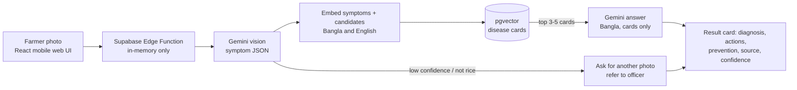

# System Architecture

## Diagram

## Request flow
1. **Upload.** Farmer takes or picks a leaf photo; the Edge Function receives it and keeps it in memory only.
2. **Observe.** Gemini vision returns structured JSON: visible symptoms (spot shape, colour, location), up to 3 candidate diseases, a confidence for each, and `photo_quality`.
3. **Retrieve.** Symptoms plus candidate names (Bangla and English) are embedded; pgvector returns the top 3 to 5 disease cards.
4. **Answer.** Gemini writes the final reply in simple Bangla using only the retrieved cards: diagnosis, what to do now, prevention, source name. If confidence is low or no card matches, it asks for another photo and points to the local agriculture officer.

An answer is only shown with a source and a confidence level.

## Design principles
- One core use case; do not overbuild
- Two-prompt split: step 1 only observes, step 2 only answers from retrieved cards
- Cards are the single source of treatment advice
- Prompts live in the repo so evaluation can be re-run after any change

## Components
| Component | Responsibility |
|---|---|
| React web app (`app/`) | Upload screen, Bangla result card, confidence badge, "ask an officer" fallback |
| Edge Function | Orchestrates vision, retrieval, answer; holds API keys |
| Postgres + pgvector | Disease cards and embeddings |
| Gemini API | Vision observation and grounded Bangla answer |
