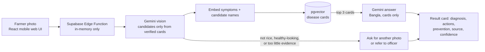

# System architecture

## Diagram

## Request flow
1. **Upload.** Farmer takes or picks a leaf photo; the Edge Function receives it and keeps it in memory only.
2. **Observe.** Gemini vision is shown the names and source symptom text of every verified card and returns structured JSON: visible symptoms (English for search, Bangla for the farmer), an overall `assessment` (healthy, listed, other, unclear), and, only if "listed", up to 3 candidates chosen from that list with the card features it sees and does not see. The code computes the confidence from that evidence (at least 2 visible features and a ratio of at least 0.5); the model's own confidence is not used.
3. **Retrieve.** Symptoms plus candidate names are embedded (Gemini embedding, 1024 dimensions); pgvector returns the top 3 verified disease cards, and the top candidate's card is always included.
4. **Answer.** Gemini picks ONE card and writes the reply in simple Bangla from that card only: diagnosis (worded as "likely"), what to do now, prevention. The app adds that card's source. If confidence is low or no card matches, it asks for another photo or points to the local agriculture officer.

An answer is only shown with a source and a confidence level.

## Design principles
- One core use case; do not overbuild
- Two-prompt split: step 1 only observes, step 2 only answers from retrieved cards
- Cards are the single source of treatment advice
- Prompts live in the repo so evaluation can be re-run after any change

## Components
| Component | Responsibility |
|---|---|
| React web app (`app/`) | Upload screen, Bangla result card, confidence badge, "ask an officer" fallback |
| Edge Function `chat` | Card-grounded follow-up Q&A about the diagnosed disease (see [[chat-assistant]]) |
| Edge Function | Orchestrates vision, retrieval, answer; holds API keys |
| Postgres + pgvector | Disease cards and embeddings |
| Gemini API | Vision observation and grounded Bangla answer |
